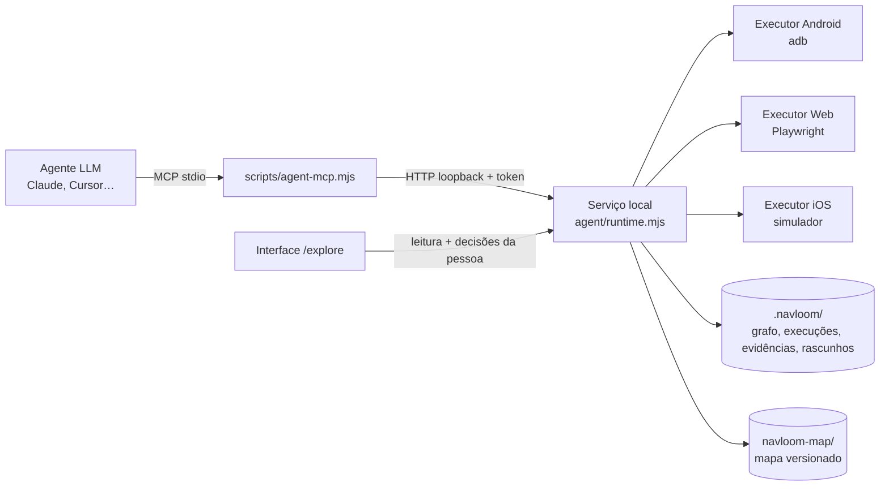

# Navloom: como funciona, ferramentas e boas práticas

Este documento explica o Navloom por dentro: o que ele captura, como reconhece telas, como monta o grafo, como navega sem gastar raciocínio do agente, como atribui chamadas de API, como nada do que uma missão encontra se perde, e o que fazer (e evitar) para tirar o melhor dele. O passo a passo de instalação e o modelo de `navloom.yaml` estão na skill do agente (`agent-skills/navloom/SKILL.md`). A referência técnica em inglês fica em `agent/README.md`.

## 1. Visão geral



- **O agente decide, o Navloom executa e lembra.** O agente escolhe ações pelo MCP; o serviço age no app, captura cada tela, compara, grava evidências e mantém o grafo.
- **A interface é de quem revisa.** Ela mostra o mapa, as execuções e a ajuda pedida. Aprovar o que uma missão encontrou, recuperar um rascunho, aprovar scripts e criar contas são decisões da pessoa, feitas só na interface. Tudo o que é trabalho do agente passa pelo MCP.
- **Tudo é local.** O serviço escuta só em loopback, com um token gerado na máquina (`.navloom/runtime.json`, modo 0600).

## 2. Uma missão, do começo ao fim

1. `navloom_memory`: lê o que já se sabe (telas, conexões, APIs, pontos de entrada, duplicadas possíveis, dúvidas de API, ajuda lembrada).
2. `navloom_start` (ou direto `navloom_goto`): abre o app e captura a tela de entrada.
3. `navloom_step` / `navloom_explore`: age e captura. Cada passo devolve a tela nova, o que mudou e as chamadas de API que a ação disparou.
4. `navloom_organize`: dá nome e descrição às telas, agrupa fluxos e corrige a dona de um endpoint.
5. `navloom_finish`: avalia asserções, junta diagnósticos e fecha a revisão.

### Modos

| Modo | Para quê | O que acontece com o que foi encontrado |
|---|---|---|
| `record` | mapear o que é novo | fica num rascunho até a pessoa aprovar em Execuções |
| `validate` | percorrer o gravado e apontar diferenças | diferenças ficam pendentes; o que bate é guardado sem perguntar |
| `walk` | só navegar (padrão do `goto`) | nada é gravado, **exceto** se a caminhada passou por algo que o mapa nunca teve: aí vira pendente |

Com `review: auto` no `navloom.yaml` a missão grava enquanto anda e só relata a comparação.

### Nada se perde

- Um rascunho pendente **não expira**. Ele espera a decisão, mesmo depois de reiniciar o serviço ou começar outras missões.
- Aprovar mescla campo a campo: uma renomeação feita no mapa gravado enquanto a missão esperava continua valendo.
- Aprovar ou descartar **arquiva** o rascunho em `.navloom/drafts/archive/` (as últimas 60 missões). Um descarte por engano tem volta: **Recuperar** em Execuções.
- Se a cópia-base que a missão tirou no início sumir (erro, limpeza), a comparação é refeita contra o mapa gravado (`baseMissing`), em vez de se perder.
- Uma missão retomada mantém o rascunho que já tinha, mesmo que a configuração de revisão tenha mudado.
- Uma caminhada do `goto` que empacou e foi continuada à mão com `step` guarda o caminho novo para revisão (`kept: walk_found_new`), em vez de jogá-lo fora.

## 3. O que o Navloom lê de cada tela (Android)

Uma única ida ao `adb shell` por captura traz:

| Dado | Fonte | Para quê |
|---|---|---|
| Activity em primeiro plano | `dumpsys activity activities` | fronteira rígida entre telas; `null` enquanto nenhuma está resumida (abertura a frio) |
| Pilha de activities do app | as linhas `Hist #` | mostrada ao agente como `activities` |
| Hierarquia de elementos | `uiautomator dump` | elementos, rótulos, ids, hints, `selected`, limites |
| Teclado aberto | `dumpsys input_method` | estado `· teclado` à parte |
| Janela em foco | `dumpsys window displays` | diálogo, menu ou folha por cima da tela |
| Fragment em exibição | `dumpsys activity <pacote>` | nome e identidade da tela em apps com fragments (só se o app tiver) |

Proteções:
- **Outro app na frente nunca vira tela.** Se o hierarchy pertence a outro pacote (não do sistema), a captura para com "Another application is in front". Isso foi visto ao vivo: um app de outro projeto veio para a frente no mesmo emulador.
- **Folhas do sistema** (preenchimento automático, permissão, teclado) desenhadas por cima do app viram um estado `diálogo` da tela de baixo.
- **O valor digitado não entra na identidade do campo**: o campo é o mesmo, com ou sem texto.
- **Relógio**: na abertura, o Navloom mede a diferença entre o relógio do aparelho e o do computador (`date +%s%3N`, três amostras, fica a de menor ida e volta), para datar as linhas do logcat com precisão.

## 4. Reconhecer telas

### A ordem de quem decide

1. Um id declarado pelo app (`navloom:screen:<id>:state:<estado>` no Compose, `data-navloom-screen` no web) ou um script `screen` aprovado. Um script pode nomear uma tela já mapeada pelo id dela.
2. O fragment em exibição.
3. **Reconhecimento por perfil**, para apps que não declaram nada (a maioria).

### Reconhecimento por perfil (`agent/recognize.mjs`)

Cada tela guarda um **perfil**: os sinais (tokens) que as capturas dela tiveram e quantas vezes cada um apareceu. Só capturas limpas ensinam o perfil: sem rolagem, sem teclado, sem diálogo.

| Sinal | Exemplo | Peso |
|---|---|---|
| título (`h:`) e sua primeira palavra (`H:`) | `h:detalhes do produto`, `H:olá` | 4 e 2 |
| aba selecionada (`n:`) | `n:produtos` | 3 |
| resource id (`i:`) | `i:cart_checkout` | 3 |
| caminho web sem ids (`p:`) | `p:/produto/#` | 3 |
| campo (`f:`) por id, hint ou posição, nunca pelo valor | `f:pix_key` | 2,5 |
| rótulo de controle (`c:`) | `c:adicionar ao carrinho` | 2 |
| texto fixo (`t:`) | `t:saldo disponível` | 1 |
| moldura do app (`k:`, `b:`): topo e barra de abas | `k:c:sair` | 0,6 e 0,3 |

Antes de virar token, o texto é normalizado: números viram `#`, valores em dinheiro viram `$`, e-mails viram `@`. "Carrinho (3)" e "Carrinho (0)" leem igual.

Uma captura nova recebe uma nota de 0 a 1 contra cada tela conhecida:

- **Cobertura (60%)**: quanto do que a tela *sempre* mostra está na captura. Cada token pesa pelo tipo × **estabilidade** naquela tela × **raridade** entre as telas (IDF).
  - A estabilidade usa um valor inicial por tipo: um texto visto uma vez vale como provável dado, um controle vale como estrutura.
  - A raridade derruba o que todas as telas têm (barra de abas, "Sair", a marca).
- **Precisão (40%)**: quanto do que está na captura pertence à tela. Conteúdo que muda (outro produto) baixa a precisão, mas não a cobertura.
- **Controles próprios**: se a captura não tem a maioria dos controles fixos da tela *e* traz controles novos, perde 0,15. É outra tela mostrando os mesmos dados (o cartão e depois o formulário de limite dele).
- **Título**: título igual soma 0,12; título fixo diferente tira 0,1, a menos que só a saudação mude ("Olá, Ana" × "Olá, Bruno").
- **A navegação também vota**:
  - rolar nunca troca de tela;
  - digitar, esperar ou rolar soma 0,25 para a tela de onde se saiu, e um clique soma 0,04;
  - `back` soma 0,1 para a tela anterior do caminho;
  - a mesma ação já feita do mesmo estado soma 0,12 para onde ela levou antes.
- **Regra de decisão**: nota ≥ 0,6 com folga de 0,05 sobre a segunda → é aquela tela. Abaixo disso, é tela nova, e as mais parecidas (≥ 0,4) seguem como `lookalike` para o agente julgar.
- **Nada na tela** (um quadro entre duas telas) → estado `carregando` da tela anterior, nunca uma tela fantasma.
- **Na dúvida, separar.** Unir duas telas diferentes é pior do que ter uma duplicada: a duplicada aparece em `possibleDuplicates` e se une com `navloom_merge`.

**Estados** são o momento da tela: `padrão`, `erro`, `carregando`, `vazio`, `concluído`, `diálogo`, com `· teclado` quando ele cobre parte da tela. O momento vem do que a tela mostra:
- textos de erro em qualquer lugar;
- "nada aqui" e "concluído" só quando são a manchete (o título ou um texto curto e grande), não uma nota de seção.

Dois estados da mesma tela são o mesmo quando têm o mesmo momento, o mesmo teclado e controles parecidos (Jaccard ≥ 0,6). Um texto ou uma lista que mudou não cria estado novo.

### Resultados medidos

Corpus real: 177 capturas de 12 telas do app de teste, com as tags removidas.

| Variante | Telas a mais | Capturas na tela errada |
|---|---|---|
| com resource ids | 0 | 0 |
| sem resource ids | 0 | 0 |
| sem título | 4 (divisões, sugeridas como duplicadas com 0,95) | 0 |
| sem ids e sem título | 1 | 0 |

Ao vivo, no emulador, com o app compilado sem tag nenhuma e sem resource ids, foram 12 telas, o mapa numa peça só e nenhuma duplicada sugerida. A identidade antiga (`[rota, título]`) teria partido o Login em 5 telas só nesse corpus.

### Duplicadas e fusão

- `possibleDuplicates` (em `navloom_memory`) e `navloom_similar` combinam o conteúdo (75%) com a **vizinhança** (25%): para onde os controles da tela levam e de onde se chega a ela.
  - Uma tela gravada duas vezes tem as mesmas saídas e entradas.
  - Duas listas parecidas (Produtos × Favoritos) são alcançadas por abas diferentes e ficam separadas (0,38).
- `navloom_merge {into, from}` une telas (ou estados, com `kind: state`). Tudo o que apontava para a tela unida passa a apontar para a mantida: estados, transições (juntadas quando ficam iguais), fluxos, entradas, deeplinks, respostas lembradas, resultados do `goto` e campos de plugins. O id antigo vira apelido.

### Script de identidade de tela

`navloom_harness {suggest: "screen"}` escreve o script a partir do mapa:
- para cada tela, o título, a aba selecionada, os ids e os textos curtos que aparecem em quase todas as capturas dela e em nenhuma outra;
- o script é conferido contra as capturas reais antes de ser oferecido;
- uma regra que reconhece captura de outra tela passa a exigir todas as âncoras e, se ainda errar, sai do script.

Em 174 capturas reais o script acertou 170, errou 0 e se absteve em 4; nessas, decide o reconhecimento por perfil. Com ele aprovado, a identidade vira uma regra legível.

## 5. O grafo e como o Navloom anda nele

- **Nós** são estados; cada estado pertence a uma tela.
- **Arestas** são transições confirmadas: a mesma ação, do mesmo estado, na mesma conta, versão e ambiente.
- Só arestas **confiáveis** entram em rotas:
  - quando a mesma ação já levou a lugares diferentes, vale o resultado com mais evidência;
  - `back` só desfaz o passo anterior;
  - um deeplink só é atalho se sempre caiu no mesmo lugar.

### `navloom_goto`: telas mais à frente sem o LLM

O grafo de decisão do destino é calculado de trás para frente, como um caminho mínimo reverso. Para cada estado conhecido, ele guarda a única ação que aproxima do destino. O `goto` então repete o ciclo observar → consultar → agir, sem raciocínio do agente.

- Custos favorecem o que só lê: uma ação que grava no backend custa mais e só é seguida quando o caminho desde a entrada precisa dela (entrar na conta, pôr um item no carrinho para ver o carrinho).
- Uma ação que já errou o destino paga por isso (`walks`/`misses`) e volta a valer conforme acerta.
- **Abas valem de qualquer tela.** Um controle da barra de abas com o mesmo nome da seção que o destino mostra selecionada vira caminho a partir de todo estado que exibe a barra. No emulador, "Aumentar limite" caiu de 7 para 5 passos.
- O que foi digitado num formulário quando a rota foi aprendida é digitado de novo; segredos, por `secretRef`.
- Recuperações: um desvio por tela desconhecida sai com voltar e, uma vez, reinicia na entrada.
- Chegar ao destino um quadro antes ou depois do "carregando" não conta como erro da rota.

**Quando o LLM entra:** só quando o `goto` volta `stuck`, com `diagnosis`.

| `cause` | Significa | O que o agente faz |
|---|---|---|
| `app_error` | o app respondeu com erro no caminho (`appSays` cita o texto); o `goto` para ali em vez de dar voltas | decidir: tentar de novo, pedir dado ou condição, relatar |
| `unknown_screen` | tela nunca vista (com `lookalike`) | mapear com `step`, ou unir se for conhecida |
| `unknown_state` | tela conhecida num estado novo | mapear com `step` |
| `no_way_forward` | estado conhecido sem saída aprendida até o destino | mapear com `step` |
| `blocked` / `paused` | falha do aparelho ou do app | ler `reason` |

`unexpected` diz o que o grafo esperava e o que apareceu. `branches` lista onde o app se divide (a mesma ação já levou a lugares diferentes, como uma compra aprovada ou recusada). Se não der para saber qual cenário a pessoa quer, o agente **pergunta** com `navloom_ask kind=decision` e as opções, em vez de adivinhar.

### Pontos de entrada e árvore de fluxo (`agent/flowgraph.mjs`)

Para cada tela, o Navloom calcula:
- o caminho mais curto desde a abertura do app em cada ambiente (Dijkstra; ações que gravam custam mais), com os segredos digitados e o que é gravado no caminho;
- os deeplinks verificados que sempre caíram nela;
- os controles que a abrem de qualquer tela (abas);
- as telas com entrada direta.

A entrada é a abertura a frio confirmada pelo `goto`; até lá, o lugar onde as missões mais começaram.

**Dominadores** (algoritmo iterativo de Cooper, Harvey e Kennedy): para cada tela, por quais telas todo caminho até ela passa. Daí vêm:
- `passa sempre por …` em cada tela; as telas por onde *todo* caminho passa (login, home) aparecem uma vez só, não em cada linha;
- a **árvore de fluxo**: cada tela sob a tela por onde todo caminho até ela passa. Um ramo é um fluxo.

Exemplo real do app de teste:

```
- Bem-vindo
  - Olá, Ana
    - Favoritos
    - Meus cartões
      - Aumentar limite
    - Produtos
      - Detalhes do produto
        - Seu carrinho
          - Confirmar compra
            - Comprovante
    - Transferir Pix
      - Confirmar Pix
```

Onde isso aparece: `entryPoints` em `navloom_memory`; **Pontos de entrada** e **Árvore de fluxo** no `navloom-map/README.md`; `entryPoints` no `map.yaml`; **Como chegar** em `navloom_screen`.

### Exploração pela fronteira mais próxima

`navloom_explore` testa os candidatos pendentes do estado atual de cima para baixo. Quando acabam, faz **uma** busca de custo mínimo até *qualquer* estado que ainda tenha candidatos e vai ao mais barato. Antes, ia ao primeiro na ordem da tela e podia atravessar o app inteiro com um candidato a um toque de distância. Mudanças automáticas (fim de carregamento, redirecionamento) viram transições `wait`.

## 6. Chamadas de API

Fontes no Android, sem root nem certificado:
- **Proxy de gravação** na porta do `adb reverse` (`network.reverse`): horário exato e a troca completa (com valores sensíveis mascarados) em `evidence/net-<id>.json`.
- **Logcat** do processo do app: OkHttp `HttpLoggingInterceptor`, linhas simples como `GET /api/x -> 200`, ou um formato próprio ensinado por um script `logcat`.

**Atribuição por horário.** Cada chamada pertence à **última ação feita antes de ela começar**:
- o horário vem da própria linha do log, convertido para o relógio do computador;
- numa linha escrita quando a resposta chega, o início é recuado pela duração;
- não importa em que passo a linha foi *lida*, então resposta lenta ou aparelho sob carga não empurra mais a chamada para a tela seguinte;
- há uma tolerância de 150 ms entre relógios;
- chamadas antes de qualquer ação são da abertura do app.

Depois disso, um GET visto ao chegar em outra tela é **carregamento** dela; o resto é efeito da ação.

**Corrigir depois.**
- `navloom_memory` traz `apiDoubts`: um endpoint quase sempre num lugar e algumas vezes em outro ("GET /api/products: 5× ao chegar em Produtos, 1× ao chegar em Detalhe").
- O agente confere e diz quem é o dono com `navloom_organize {apis:[{endpoint, screen, role: load|action, via?}]}` (ou `navloom_apis`, no nível estendido).
- A regra vale para as próximas chamadas e **reatribui o que já foi gravado** a partir das evidências das execuções. `remove: true` desfaz a regra.

## 7. Scripts aprendidos e ajuda

| Script | Recebe | Devolve |
|---|---|---|
| `logcat` | `{line}` | `{url, method?, status?, ms?}` |
| `screen` | `{platform, route, heading, texts[], ids[], section}` | `{screen, state?, name?}` |
| `path` | `{method, host, path}` | modelo como `/api/products/{id}` |

Nada que o agente escreve roda antes de uma pessoa aprovar no painel Harness. Na aprovação os exemplos rodam e o script só ativa se todos conferirem. O código roda isolado (contexto V8 à parte, só JSON, 25 ms por chamada).

**Ajuda (`navloom_ask`)**: credencial, valor, decisão, pré-condição, ambiente ou conta. A pergunta aparece no chat do agente (elicitation do MCP) ou no painel Ajuda. A resposta fica lembrada; segredos só em `.navloom/secrets.json`, fora do git.

## 8. Contas e ambientes

Um **perfil** é uma conta; um **ambiente** é o mesmo app em outro lugar (mock, staging).
- Telas e estados são compartilhados e registram quem os viu.
- Transições, APIs e entrada são por ambiente.
- O `goto` reaproveita caminhos de outro ambiente com custo um pouco maior.
- Na validação, uma diferença explicada por conta ou ambiente aparece como **varia**, não como erro.

## 9. Mapa versionado

`navloom-map/` (commite):
- `map.yaml`: telas, estados com hotspots, transições com APIs, deeplinks, endpoints, fluxos, pontos de entrada, apelidos de fusão;
- `README.md`: com Pontos de entrada e Árvore de fluxo;
- `states/*.jpg`: miniaturas.

Um checkout limpo carrega o mapa quando `.navloom/graph.json` não existe; os perfis de reconhecimento são refeitos a partir dos controles salvos. Revise as miniaturas antes de commitar: elas mostram dados reais. Nunca commite `.navloom/`.

## 10. Ferramentas MCP

**Núcleo** (padrão; cada definição custa tokens em todo turno, por isso o catálogo fica abaixo de 14,5 mil caracteres):

| Ferramenta | Use para |
|---|---|
| `navloom_memory` | começar: o mapa inteiro em texto, com pontos de entrada, duplicadas e dúvidas de API |
| `navloom_goto` | chegar a qualquer tela conhecida, por mais funda que seja, sem raciocinar |
| `navloom_start` | abrir uma missão com modo, conta e ambiente |
| `navloom_step` | uma ação; devolve a tela nova |
| `navloom_explore` | testar em lote os candidatos pendentes |
| `navloom_frontier` | ver o que falta testar |
| `navloom_observe` | capturar de novo (raro: step e goto já devolvem a tela) |
| `navloom_screen` | uma tela em poucas linhas, com "Como chegar" |
| `navloom_run`, `navloom_finish`, `navloom_pause`, `navloom_resume` | acompanhar e fechar a missão |
| `navloom_merge` | unir telas ou estados gravados duas vezes |
| `navloom_organize` | nomes, descrições, fluxos e a dona de cada endpoint |
| `navloom_ask`, `navloom_answer`, `navloom_help` | pedir e registrar ajuda |
| `navloom_harness`, `navloom_harness_propose`, `navloom_logs` | scripts aprendidos (inclusive o de tela sugerido) |
| `navloom_evidence` | imagem ou JSON de uma captura, quando o texto não basta |
| `navloom_status` | contadores e missão ativa |

**Estendidas** (`--tools=extended`): `similar`, `apis`, `review`, `route`, `replay`, `probe`, `transition`, `describe`, `annotate`, `group_flow`, `deeplinks`, `capabilities`, `reset`, `compare`, código-fonte (`source`, `search_source`, `source_tree`, `link_suggestions`, `link`), `export_map`, `forget_help`, `dismiss_request`.

## 11. Boas práticas

### No app (quem desenvolve)

- **Melhor de tudo:** declare a tela. No Compose, `Modifier.semantics { contentDescription = "navloom:screen:<id>:state:<estado>" }` na raiz de cada tela e `testTagsAsResourceId = true`. No web, `data-navloom-screen` e `data-navloom-state`. Identidade declarada não depende de semelhança.
- Sem isso, ajuda muito:
  - um título por tela na barra superior;
  - `testTag` nos controles principais (vira resource id);
  - `selected` correto nas abas (o `NavigationBar` do Material já faz isso);
  - campos com `hint` ou `testTag`.
- Logue **uma linha por requisição** no processo do app (OkHttp logging, ou `Log.i(tag, "GET /caminho -> 200")`). Com duração na linha (`(35ms)`), o horário de início é exato.
- Em desenvolvimento, coloque o backend atrás de `adb reverse` e configure `network.reverse`: o proxy dá horário exato e a troca completa.

### Para o agente

- Comece por `navloom_memory`, uma vez. Não repita a cada passo.
- **Telas conhecidas: só `navloom_goto`.** Nada de passar tela a tela com `step`.
- Raciocine só quando o `goto` voltar `stuck`: leia `diagnosis`, mapeie o caso novo com `step` (ele entra no grafo) e, na dúvida sobre cenário ou fluxo, pergunte com `navloom_ask kind=decision`.
- Prefira o texto (`detail: "digest"`) à imagem. Peça `navloom_evidence` só para o que o texto não mostra.
- Explore em lotes (`navloom_explore`, 8 a 15 candidatos).
- Diante de `screen.new` com `lookalike`: compare e una com `navloom_merge` se for a mesma tela. Duas telas diferentes que se parecem ficam separadas.
- Depois de mapear as telas principais: `navloom_harness {suggest: "screen"}` e `navloom_harness_propose`.
- Resolva `apiDoubts` com `navloom_organize {apis: …}`.
- Feche com `navloom_organize` (nomes, descrições de negócio, fluxos) e `navloom_finish`. Quando o finish disser `review: pending`, avise a pessoa; o agente não aprova por ela.

### Para quem revisa

- Pendentes não expiram: revise quando puder. Descartou sem querer? **Recuperar**.
- Na validação, vermelho é o que mudou na mesma conta e ambiente; "varia" é diferença explicada por outra conta ou ambiente.
- Leia o código de um script antes de aprovar.

### Ambiente de teste

- **Um emulador por projeto.** No teste ao vivo, outro projeto usava o mesmo emulador: um app dele veio para a frente e as capturas ficaram 10 vezes mais lentas. Hoje o Navloom recusa o outro app, mas a missão para.
- Imagens Android "Play Store" atualizam serviços em rajadas depois do boot a frio. Prefira uma imagem sem Play Store para testes, ou espere a carga baixar.
- Use contas descartáveis: as capturas e miniaturas mostram os dados que o app exibe.

## 12. Solução de problemas

| Sintoma | Causa provável | O que fazer |
|---|---|---|
| A mesma tela aparece duas vezes | identidade estrutural fraca (sem título, sem ids) ou um mapa antigo | `possibleDuplicates` → `navloom_merge`; depois o script de tela sugerido |
| Duas telas diferentes unidas | conteúdo e controles quase iguais e nenhuma aba ou título que as distinga | declarar a tela no app; um script de tela aprovado vence a semelhança |
| Chamada de API na tela errada | resposta lenta lida um passo depois (resolvido pelo horário da linha) ou ambiguidade real | `apiDoubts` → `navloom_organize {apis}` |
| "Another application is in front" | outro app tomou a frente no aparelho | liberar o aparelho; um emulador por projeto |
| Capturas lentas, "Command failed" | aparelho ou computador sobrecarregado (o `adb` tem 15 s por captura) | ver a carga (`adb shell cat /proc/loadavg`); fechar o que estiver competindo |
| `goto` parou com `app_error` | o app mostrou erro (login recusado, serviço fora do ar) | ler `appSays`; corrigir a condição ou perguntar à pessoa |
| Um fluxo "sumiu" | missão descartada, ou rascunho perdido numa versão anterior | Execuções → Recuperar (`.navloom/drafts/archive/`) |
